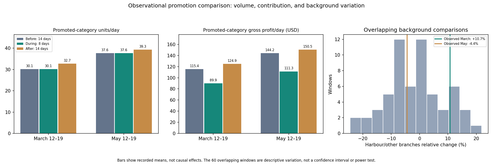

# Stories Coffee: a playbook for abrupt change

**EECE490 Stories Coffee Hackathon**

**Team:** _<add every team member's full name here>_ · Repository owner: `sarmadosman`

---

## The answer in one paragraph

Stories' recorded orders increased during the overlapping war-context, Ramadan, and Lent periods, while selected aggregate trading measures remained broadly similar. This does not establish equivalence or exclude branch, product, or calendar effects. Two Harbour promotion windows recorded **$471.55 in discounts relative to listed prices**; their observational comparisons do not establish whether the discounts paid for themselves because no-promotion demand is unknown. Among **1,978 identified baseline accounts, 1,692 were observed again within 56 days and 286 were not observed**—account-return measures, not permanent-loss estimates. Customer findings cover identified accounts only; **36.5% of orders lack IDs**, and cross-branch results assume globally consistent IDs. The playbook is to test recent-demand preparation, use randomized promotion holdouts judged by total contribution after incremental costs, and compare precisely defined 28- versus 56-day contact timing. Conditional scenarios remain separate from measured outcomes; the overlapping events do not permit clean causal attribution.

---

## 1. Business problem

> **How can Stories apply changes to maximize profit in times of abrupt change?**

When conditions shift suddenly, management faces three pressing decisions. **(a)** Should we change capacity, menu or hours? **(b)** Should we discount to protect traffic? **(c)** Are we losing customers, and should we try to win them back? Each one can cost money if Stories reacts to a shock that is not actually happening in its sales. We use the war/Ramadan/Lent period as a test case: what really changed, what did not, and what Stories should do the next time.

The question is **not** "how much did the war cost?" That question cannot be answered from this data (see §5). The question is which decisions the observed changes support.

## 2. Strategy and context

### 2.1 Three events in one window

The three events overlap almost completely. That makes it impossible to cleanly separate their effects:

| Phase (2026, inclusive) | Days | Orders/day | Gross profit/day | GP/order | Evening share (18:00+) | Takeaway share | Discounted-unit share |
|---|---:|---:|---:|---:|---:|---:|---:|
| Before everything (Jan 1–Feb 16) | 47 | 152.4 | $809 | $5.31 | 50.0% | 41.0% | 5.9% |
| Ramadan + Lent, pre-war (Feb 18–Mar 1) | 12 | 158.3 | $835 | $5.28 | 50.2% | 40.2% | 5.2% |
| **Ramadan + Lent + war (Mar 2–18)** | 17 | **186.1** | **$983** | $5.28 | 50.4% | 41.3% | **9.1%** |
| Lent + war (Mar 19–Apr 2) | 15 | 180.3 | $960 | $5.32 | 51.0% | 39.7% | 6.3% |
| War only, both religious periods over (Apr 3–Jun 30) | 89 | 210.3 | $1,112 | $5.29 | 50.4% | 41.0% | 6.6% |

Feb 17, the only day that is Ramadan but not Lent, is excluded from the table. A single day cannot support conclusions. Source: [calendar_phase_summary.csv](reports/calendar_phase_summary.csv).

### 2.2 How we compared before and after

Since the events cannot be separated, we did not try to assign effects to each one. We asked what changed across the whole disruption, and then whether each change was unusual compared with normal weeks. The methods:

1. **Matched windows.** We compared the 28 days before March 2 (Feb 2–Mar 1) with the 28 days after (Mar 2–29). Both windows contain the same mix of weekdays. We repeated this with 7-, 14- and 42-day windows, and around the start and end of Ramadan and Lent.
2. **Alternative cutoffs (placebo dates).** We ran the same 28-day before/after comparison at 19 other dates. Similar increases at other cutoffs weaken the interpretation that the observed growth uniquely marks March 2; they do not rule out conflict-related effects.
3. **Forecasts trained only on pre-war data.** We used three simple models, each tested chronologically on data it had not seen. Their March projections give an "earlier patterns continued" reference, not a verified no-war outcome.
4. **An observational promotion comparison.** Harbour ran the same promotion twice; Garden and Uptown did not. We compared Harbour with the other two branches before, during and after each wave. We then repeated the comparison for 60 overlapping non-promotion windows to describe background variation; these are not independent experiments or a power analysis.
5. **Customer cohorts.** We froze the pre-war customer list, then tracked where (which branch) and when (28 versus 56 days) those customers showed up again.
6. **Calendar regressions** as a cross-check: weekday effects, a trend term, and separate Ramadan, Lent and post-March-2 indicators, with robust (HAC) errors and five model specifications.

## 3. Data and quality checks (observed facts)

| Check | Result |
|---|---|
| Rows / orders / products | 51,177 item lines · 33,887 orders · 45 products · 3 branches (Harbour, Garden, Uptown) |
| Period | Jan 1–Jun 30, 2026: about 60 days before the war and 120 after |
| Accounting consistency | Revenue = qty × price × (1 − discount) to within $0.005 on every line; gross profit = revenue − cost exactly |
| Exact duplicate lines | 132 (0.26%). Kept. Removing them leaves order counts and forecasts unchanged and moves GP/order by < $0.02 ([duplicate_sensitivity.csv](reports/duplicate_sensitivity.csv)) |
| Missing Customer ID | 36.5% of orders, similar before and after (64.3% vs 63.4% identified) |
| Prices | Each product has **one list price per branch for the whole half-year**, so price changes appear only as discounts (10% or 15%) |
| Discount rates | 93.4% of lines at 0%, 5.6% at 10%, 1.0% at 15% |
| Transaction IDs | Replacement IDs (`SYN-…`), as the brief states |

Full details: [data_quality.json](reports/data_quality.json), [data/README.md](data/README.md).

---

## 4. Three conclusions, and what to do next time

Each conclusion lists **what we measured**, the **alternative explanations we tested**, **what Stories should do when this happens again**, and the **estimated value**. The value is always built on stated assumptions and kept separate from the measured results.

### Conclusion 1: Recorded orders increased, while selected aggregate trading measures remained broadly similar.

**Measured:**

- Orders in the 28 days after March 2 were **+9.1%** above the 28 days before (4,611 → 5,030). The week of March 2 was **+12.8%** over the previous week. That is the biggest week-over-week jump in the half-year, but normal weekly changes vary by about 5.6%, and +12.8% is only about 2 standard deviations.
- **The rise is not unique to March 2.** The same 28-day comparison at 19 other dates gives **+5.9% to +10.7%** ([alternative_cutoff_comparisons.csv](reports/alternative_cutoff_comparisons.csv)). Stories was growing steadily all half-year, from about 143 orders/day in early January to about 225 in late June.
- **Selected aggregate measures remained broadly similar.** Across the multi-day phases, evening share ranged from 50.0% to 51.0%, takeaway share from 39.7% to 41.3%, recorded gross profit per order from $5.28 to $5.32, and meal attachment from approximately 2.0% to 2.4%. These aggregates do not establish equivalence, exclude branch/product changes, or rule out calendar effects.
- **The size of the change differed by branch.** Against forecasts trained only on pre-war data, the 28 days after March 2 came in at **Harbour +10.4%**, **Uptown +7.7%** and **Garden −2.2%** ([projection_summary.csv](reports/projection_summary.csv)). Garden's figure changes sign depending on the model (−2.2% to +5.1%); Harbour's (+5.3% to +12.0%) and Uptown's (+7.7% to +13.0%) do not ([projection_model_sensitivity.csv](reports/projection_model_sensitivity.csv)).
- **The models were compared with simple baselines on data they never saw.** For daily order forecasts we tested three candidates chronologically: previous same weekday, mean of the last four same weekdays, and trend plus weekday. The simplest rule, "same as last week", lost at every branch. 14-day MAE was 10.52 vs 9.87 orders/day at Harbour, 8.05 vs 6.26 at Garden, and 6.81 vs 4.35 at Uptown ([forecast_backtest_scores.csv](reports/forecast_backtest_scores.csv)). For food preparation, "mean of the last four same weekdays" beat "last week" on four months of out-of-sample data (Mar 2–Jun 30): Harbour bakery MAE fell from 7.52 to 5.49 units/day and meal MAE from 2.90 to 2.20 ([preparation_backtest.csv](reports/preparation_backtest.csv)).

**Alternative explanations tested:** We tested whether the increase was a war effect, a Ramadan effect or a Lent effect. In five regression specifications, the Ramadan estimate is +1.7% to +2.4% and the Lent estimate −3.7% to −1.6%, with every 95% interval including zero. The post-March-2 estimate is +3.4% to +6.6%, and four of the five intervals include zero ([calendar_adjusted_associations.csv](reports/calendar_adjusted_associations.csv)). Ramadan and Lent overlap so much that their indicators have a correlation of 0.72. Our reading is that the rise is mostly ongoing growth, with a possible extra step around March 2 that we cannot reliably separate from the trend.

**What to do next time:**
1. **Don't cut capacity or stock because of the headline.** Plan each branch from the last four same weekdays, which was the better rule in our test. Re-forecast weekly.
2. **Use observed demand before changing hours or menu.** Selected aggregate measures remained broadly similar, but they do not exclude calendar, branch, or product effects. Monitor availability, service outcomes, and daypart/category demand against pre-agreed operational thresholds before wider changes.
3. **React at branch level.** Harbour and Uptown were above the selected pre-war point projections, while Garden's result depends on the model used. Changes to staffing and stock should be decided branch by branch, not chain-wide.

**Estimated value (conditional):** Say Stories had planned March from the pre-war forecast and every order above it had been lost to stock-outs or slow service. That would put at risk about 227 Harbour orders and 69 Uptown orders, roughly **$1,700 of recorded gross profit in 28 days** (orders × each branch's GP/order). This is an upper bound. We cannot see stock-outs or wait times, so we don't know how many of those orders a tighter plan would actually have lost.

**Figure 1 — demand and calendar overlap:** [calendar_timeline.png](reports/figures/calendar_timeline.png) shows the order trend alongside evening share and recorded contribution per order. Read their different movements together; aggregate similarity does not establish unchanged customers or a causal event effect.

### Conclusion 2: The observed promotion results do not establish that the discounts paid for themselves.

**Measured:** Harbour ran **the same promotion twice**: 15% off every Cold Coffee and Desserts item (Iced Latte, Cold Brew, Iced Americano, Cheesecake, Brownie and others) on **Mar 12–19**, inside the war/Ramadan window, and again on **May 12–19**, outside the supplied Ramadan/Lent periods and away from the March 2 onset. Garden and Uptown had no comparable recorded 15%-off pattern. The weekly discount spikes are visible in [promotions_and_cutoffs.png](reports/figures/promotions_and_cutoffs.png).

| Harbour, promoted categories | Mar 12–19 wave | May 12–19 wave |
|---|---:|---:|
| Promoted units/day: 14 days before → during | **30.1 → 30.1** | **37.6 → 37.6** |
| Same, relative to Garden + Uptown | +10.7% | −4.4% |
| Promoted-category gross profit/day, during vs average of before and after | $120 → $90 (**−25%**) | $147 → $111 (**−24%**) |
| Discount relative to listed prices | **$209.87** | **$261.68** |
| First-observed IDs among promoted-item buyers | 19 of 133 | 2 of 160 |

- **Break-even test.** At Harbour's prices and costs, 15% off cuts the gross profit on each promoted unit from $3.86 to $2.99. Holding costs and product mix fixed, discounted units need to rise by **+29.3%** (+24% to +36% depending on the product) to match full-list-price gross contribution. This is a same-mix accounting benchmark, not a measured causal effect or the pilot's sole success criterion.
- **Uncertainty:** the 60 overlapping non-promotion windows produced relative changes with a central 95% range of approximately −21% to +16%. The observed promotion comparisons, +10.7% and −4.4%, lie within this background variation. This does not establish zero effect or rule out a break-even effect: negative background variation can mask positive promotion effects. These overlapping windows are descriptive sensitivity checks, not independent experiments or a calibrated power analysis.
- Harbour's observed total-order comparisons relative to the other branches were +4.5% in March and −4.1% in May. These figures do not identify incremental visits caused by the promotion.

**Alternative explanations considered:** (a) *Calendar.* The May window is outside the supplied Ramadan/Lent periods and away from the March 2 onset, but two comparisons cannot exclude calendar or trend confounding. The March relative comparison may also reflect movements in the other branches. (b) *Chain-wide movements.* The comparison adjusts for common movements if the branches would otherwise have followed comparable relative trends. (c) *Customer acquisition.* We counted first-observed IDs among promoted-item buyers; these counts do not establish incremental customer acquisition. (d) *Slower effects such as loyalty or later visits.* Not measured; these could change the total business effect.

**What to do next time:**
1. **Test a blanket promotion before scaling it.** The observed comparisons do not establish its incremental contribution.
2. **If a promotion is needed for other reasons (brand, competition), build in a test.** Randomize eligible days, blocks, or branches into promotion and holdout conditions. Expand only if the randomized comparison shows a pre-agreed worthwhile improvement in total branch gross contribution after discounts and incremental operating costs. Report promoted-category units and the approximately 29% same-mix break-even benchmark as supporting measures.
3. **Consider smaller or targeted offers as test alternatives.** At 10% off, the same-mix accounting break-even benchmark is about +18%; actual total contribution must still be measured.

**Measured:** the two promotion windows recorded $471.55 in discounts relative to listed prices. This is not a measured causal profit loss: the quantities customers would have purchased without the promotion are unknown. **Conditional scenario:** holding quantities and product mix unchanged, charging full listed prices would have increased recorded gross profit by $471.55. Ordinary discounts, changes in demand, substitution, and later purchases could reduce or reverse that difference. We recommend a randomized holdout before repeating the promotion.

Evidence: [promotion_natural_experiment.csv](reports/promotion_natural_experiment.csv), [promotion_placebo.csv](reports/promotion_placebo.csv). Reproduce: `python3 scripts/promotion_test.py`.

**Figure 2 — promotion comparison and uncertainty:**



The left panels show recorded category units and gross contribution before, during, and after each wave. The right panel locates the observed relative comparisons within the 60 overlapping background windows. It is not a null distribution or a power test; the bars do not identify no-promotion outcomes.

### Conclusion 3: Check chain-wide activity and test inactivity thresholds before targeting customers.

**Measured:** Customer findings cover identified accounts only; 36.5% of orders lack IDs. Cross-branch results assume globally consistent IDs.

Among the 1,978 identified accounts active in the baseline window, 1,692 were observed again within 56 days and 286 were not observed. These are observed-account return measures, not estimates of permanent customer loss.
- **Observed audience breadth and order frequency.** Active identified accounts rose from **1,978 to 2,104 (+6.4%)**, while identified orders per active account rose from 1.498 to 1.515 (+1.2%). About **84%** of the extra identified orders is the audience-breadth component of the exact accounting decomposition, not a causal attribution ([customer_growth_decomposition.csv](reports/customer_growth_decomposition.csv)).
- **First observed is not acquired.** Of 900 IDs observed after March 2 but not in the previous 28 days, **508 were previously observed earlier in the file**. The other 392 are first observed in the available history; these counts do not establish incremental acquisition.
- **Observed return over complete follow-up.** Among the 1,978 identified baseline accounts, 1,204 were observed again within 28 days and 1,692 within 56 days. Of 774 baseline accounts unobserved during the first 28-day follow-up, 488 appeared during days 29–56. Their returns may already have been influenced by existing activity or interventions. This count does not measure avoidable incentives or prove that earlier contact would be ineffective. Similar horizon differences occur at other cutoffs; this does not identify a uniquely conflict-related pattern ([customer_followup.csv](reports/customer_followup.csv)).
- **Cross-branch observed activity.** Among baseline accounts not observed again at their original branch during the next 28 days, the share observed elsewhere was 49.2% for Garden, 38.9% for Harbour, and 50.7% for Uptown. Branch cohorts overlap and must not be summed as unique customers. Customer findings cover identified accounts only; 36.5% of orders lack IDs. Cross-branch results assume globally consistent IDs. These observations do not establish relocation or a conflict-driven change ([customer_branch_continuity.csv](reports/customer_branch_continuity.csv)).
- A fixed group of 584 repeat customers, chosen from data before both comparison windows, made 504 orders before and 513 after, with gross profit at $2,662 before and $2,657 after. These selected cohort totals were broadly similar; they do not establish unchanged individual habits or equivalence ([customer_fixed_cohorts.csv](reports/customer_fixed_cohorts.csv)).

**Alternative explanations considered:** (a) *Regression to the mean.* The 584-account group was fixed in earlier data, before both comparison windows, and members with zero later visits remain in the denominator. (b) *Longer follow-up.* Longer windows mechanically allow more observed returns; later appearance does not show that earlier contact would be ineffective. The historical windows are not individual last-purchase-indexed eligibility calculations. (c) *Missing IDs.* Unidentified transactions may hide visits, and capture may be selective; these results cannot estimate permanent loss in the full customer population.

**What to do next time:**
1. **Check chain-wide identified activity before targeting an account.** An account observed at another branch has an observed chain-wide purchase. This does not establish that a branch-specific absence is permanent loss, or identify the best intervention.
2. **Test intervention timing.** Compare contacting accounts after 28 days without an identified chain-wide purchase with contacting them after 56 days if they remain inactive. Historical returns do not establish which timing produces higher incremental contribution.
3. **Test repeat-visit service against a control.** Distinguish previously observed accounts from first-observed IDs and measure incremental chain-wide contribution. The historical comparisons do not establish which retention or promotion policy offers the best return.

**Estimated value (conditional):** If a retention effort caused just 1% of the 1,978 baseline identified accounts to make one genuinely additional order, it would add about **$103 of recorded gross profit**, using the observed approximately $5.22 per identified order, before intervention and other incremental operating costs. The response rate is an assumption, not a measurement. The 488 observed later returns are not an avoided-incentive estimate.

**Figures 3–4 — where and when accounts are observed:** [customer_branch_continuity.png](reports/figures/customer_branch_continuity.png) separates same-branch activity, other-branch-only activity, and chain-wide non-observation. [customer_followup.png](reports/figures/customer_followup.png) shows the same cohort under complete 28-/56-day follow-up and checks other cutoffs. These support activity checks and a timing trial; they do not prove permanent loss, organic return, or an optimal waiting period.

---

## 5. Weak areas, uncertainty and possible failures

| Weakness | Why it matters | Effect on our conclusions |
|---|---|---|
| **Ramadan, Lent and the war overlap; there is one season and no comparison year** | We cannot say how much of any change belongs to which event | We claim only what changed during the combined period, not causes. All three conclusions concern decisions, not attribution |
| **Strong underlying growth** | Any before/after comparison partly reflects the trend | Conclusion 1 explicitly says the rise is mostly trend. Every alternative cutoff shows similar growth |
| **No control branch** | All three branches were exposed to the same events | For promotions, Garden and Uptown act as the comparison only because they ran no promotion. A shock that hit only Harbour during the promo weeks would bias the result |
| **Only two promotion waves, both at one branch, both the same design** | Two consistent results are not proof for other branches, depths or products | The recommendation is a holdout test, not a ban. Garden and Uptown customers might respond differently |
| **36.5% of orders have no Customer ID** | Customer findings cover identified accounts only; missing IDs may not be random | Unidentified transactions may hide visits; missingness and capture changes can bias cohort comparisons. Findings concern identified accounts, not the full population |
| **Customer IDs assumed stable and shared across branches** | Cross-branch findings depend on it | If IDs differ between branches, the 94% multi-branch figure is an artefact. Verify with the loyalty system |
| **Signs the data may be synthetic or sampled** | "SYN-" IDs, one fixed price per product, 94% of customers using several branches, very stable shares | Patterns may be cleaner than in real operations. Dollar amounts reflect the dataset's size and should not be read as company totals |
| **Gross profit excludes labour, rent, waste and stock-outs** | Profit here is recorded revenue minus recorded product cost | Value estimates are gross-profit estimates. Missed demand from stock-outs (Conclusion 1) is invisible |
| **No opening hours, stock-outs, wait times or marketing calendar** | Low sales could mean closed, sold out or low demand | Forecasts predict recorded sales, not true demand |
| **Short forecasting history** | Only about 60 pre-war days: three overlapping 14-day test folds and one 28-day fold | Forecast errors are rough development estimates, not guaranteed accuracy. The bands in [demand_projection.png](reports/figures/demand_projection.png) are not calibrated intervals |
| **Many comparisons** | Windows, branches and models multiply the chance of finding something | We report full tables and model ranges, not the most favourable result, and we built conclusions only on patterns that repeat across windows or cutoffs |

**Where uncertainty remains.** Promotion effects may include unmeasured later purchases, substitution, and operating costs. Similar aggregate measures do not guarantee a future shock will preserve demand or its distribution. Customer timing results depend on complete follow-up and globally consistent IDs, and the more profitable contact policy requires a randomized comparison.

## 6. Practical tests Stories can run before wider use

| Test | Design | Success criterion agreed in advance |
|---|---|---|
| **Promotion holdout** (Conclusion 2) | Next planned promotion: randomise days (or branches) into promo and full price over 4+ weeks, so both groups face the same calendar | Expand only if the randomized comparison shows a pre-agreed worthwhile improvement in total branch gross contribution after discounts and incremental operating costs. Report promoted-category units and the approximately 29% same-mix break-even benchmark as supporting measures. |
| **Win-back timing** (Conclusion 3) | Eligibility begins 28 days after each account's last recorded chain-wide purchase. Randomize eligible accounts to contact immediately or wait another 28 days and contact only if still inactive | Evaluate both groups for 56 days from randomization, retaining every assigned account in the denominator. Measure chain-wide gross contribution after intervention and incremental operating costs |
| **Recent-demand preparation** (Conclusion 1) | At one branch for 4 weeks: prepare from the 4-week same-weekday average, and log waste and stock-out times | Waste units, stock-out hours and sales compared with the previous rule at a similar branch |
| **Data fixes (no cost)** | Log opening hours, stock-outs and promotion dates; confirm IDs are the same across branches; push for more orders with an ID | Makes all three conclusions measurable next time |

## 7. Assumptions (kept separate from facts)

| Assumption | Source | If wrong |
|---|---|---|
| War-context cutoff = **March 2, 2026** | Team context. During our ChatGPT research, web searches found UN and UNICEF reports dating the escalation in Lebanon to March 2, 2026. The date was not detected from the sales data | The alternative cutoffs show the conclusions don't depend on this exact date |
| Branch names (Harbour, Garden, Uptown) don't tell us where the branches are or how exposed each was to the conflict | No location mapping was supplied | We make no claims about which branch was more affected by the war |
| Ramadan **Feb 17–Mar 18**, Lent **Feb 18–Apr 2**, inclusive | Team-supplied calendar | Small shifts of a day or two change the phase table slightly but not the conclusions |
| Calendar periods describe the calendar, not customers | Nobody's religion or fasting is known | We make no claims about who observes what |
| Recorded unit cost is the right cost for gross profit | Data dictionary | Break-even lift and dollar values scale with true margins |
| Harbour's discounts on Mar 12–19 and May 12–19 were planned promotions | 15% applied to every promoted-category unit, at Harbour only | If they were system errors, verify and correct the configuration, then measure demand and contribution rather than assuming an unchanged-volume gain |
| For the conditional full-list-price scenario, quantities and product mix are held unchanged | Scenario assumption, not established by similar before/during units | The background comparisons do not establish the unobserved promotion-period counterfactual. Demand, ordinary discounts, substitution, and later purchases could reduce or reverse the scenario difference |
| A missing Customer ID is unknown, not one anonymous customer | Our method choice | Customer counts cover identified accounts only |
| Exact duplicate lines are real sales | Meaning unknown | Removing them changes nothing material |

## 8. Approaches we considered and rejected

- **Estimating "the cost of the war".** Without a comparison year or an unaffected branch, any such number would be invented. We quantified decisions instead.
- **An ML model of "sales if there had been no war".** We proposed this early on. With about 60 days of pre-war history and no unaffected branch, a model cannot tell us what would have happened without the war. We kept a weaker but honest version: simple models trained only on pre-war data, each tested chronologically against simpler rules, and described as "earlier patterns continued", not "no war".
- **Complex ML forecasting.** The same 60 days cannot support it. The four-week same-weekday average is enough for the preparation decision.
- **Copying approaches from earlier hackathon repositories.** We reviewed six previous EECE490 submissions (see §9). The dashboards and classifiers there often had weak evaluation. One compared models on test sets that overlapped its training data by 80.8%. Another reported hard-coded accuracy figures. We took their workflow structure and avoided their claims.
- **Making Garden's low margin the headline.** This was our first lead. Garden's recorded margin (about 47% vs Harbour's 65%; gross profit per order $4.19 vs $5.98) is real but **stable in every phase** (46.8–47.2%), so it is not a response to the disruption. It is a separate cost-recording or procurement question ([same_product_economics.csv](reports/same_product_economics.csv)): for the same products, Garden's recorded costs are about 43% higher and its prices about 4.8% lower. Matching Harbour's costs would add about $15,923 over six months, but that is a benchmark, not a saving Stories can count on.
- **A Ramadan/Lent menu or hours redesign.** Selected aggregate evening and meal measures were broadly similar; this does not establish equivalence or exclude calendar effects. Menu categories also do not establish suitability for fasting.
- **Meal-plus-drink versus bakery-plus-drink bundles.** This was our main plan for a while (§9). Meals have the highest gross profit per unit ($5.46) but are rarely bought with drinks (2.4% of drink orders, vs 23.0% for bakery). Bakery would need about 2.2× as many genuinely extra purchases to match meals, or 3.1× with a $1 discount. Past co-purchases cannot show whether a suggestion creates extra sales. That needs a randomised test, sketched in [docs/food_offer_pilot.md](docs/food_offer_pilot.md), and Conclusion 2 is a reason to test normal-price suggestions before any bundle discount.
- **A churn or lifetime-value model.** Coffee customers never cancel, so "churn" is never directly observed. Transparent cohort tracking describes observed return over different horizons; a randomized timing trial is needed to compare 28- versus 56-day contact policies.
- **A "chat with your sales data" dashboard.** The brief rules this out, and it would not support a decision.

## 9. How we got here: project history

We worked with AI assistants throughout: ChatGPT for exploration and framing, then Codex to build the reproducible pipeline, then Claude Code to re-check the work and write this README. We list the path, including the ideas we dropped, because the dead ends shaped the final conclusions. Every number in §4 was recomputed from the raw CSV in the final pass. Nothing is carried over from the AI sessions unchecked.

**Stage 1: ChatGPT exploration** ([shared conversation](https://chatgpt.com/share/6ad35e6d-d08c-83eb-a1e8-26889dcb5a3f))

| Step | What we did | What we learned | What it changed |
|---|---|---|---|
| 1. Checked the brief | Checked the PDF for hidden or embedded instructions | None found. The "No questions are allowed" line is a rule for the competition | We state our own assumptions instead of asking for clarification (§7) |
| 2. Understood the data | Profiled the CSV: 51,177 lines, 33,887 orders, 45 products, 36.5% missing IDs, 132 exact duplicates, accounting checks to within a cent | Gross profit is revenue minus recorded product cost only, not net profit | Became the data-quality checks in §3 |
| 3. First lead: Garden | Compared branches | Garden earns $4.19 gross profit per order vs Harbour's $5.98. Its costs for the same products are about 43% higher and its prices about 4.8% lower | Became a supporting finding. It is stable across phases, so it is not about change (§8) |
| 4. Reviewed past submissions | Audited six earlier EECE490 hackathon repositories | Common failures: model comparisons on overlapping test sets (80.8% overlap in one), simulated or hard-coded accuracy figures, impact numbers taken from fixed rules | We adopted simple baselines, testing on unseen data, and scenarios kept separate from measurements |
| 5. War idea | Proposed operating Stories through the war that began March 2 in Lebanon. Web searches found UN and UNICEF reports dating the escalation to March 2 | **There was no sales collapse.** Orders/day went from 164.7 to 179.6 (+9.1%), average ticket $9.02 → $9.01, takeaway share 41.0% → 40.6%. Against the pre-war trend and weekday pattern, the excess was only about +3.2% | Became the starting point of Conclusion 1 |
| 6. EDA notebooks | Built two Colab notebooks: one with 9 charts (data quality, trends, weekday/hour heatmaps, branch margins, product contribution, alternative cutoffs) and one with before/after category scatters and branch heatmaps | Harbour Cold Coffee units were up 16.1%, but gross profit per unit fell 5.7% and the discounted share rose 24.2 points. The first assistant reply had already pointed to Harbour's 15% March/May discounts as "a promising promotion study" | Notebooks kept in `notebooks/reference/`. The discount lead became Conclusion 2 |
| 7. Meal-plus-drink idea | Asked whether meals (highest profit per unit) could be paired with the most popular drinks | Meals: highest per-unit profit ($5.46) but lowest total contribution. Only 1.7–2.7% of drink orders include a meal. Bakery would need about 2.2× as many extra sales to match meals | Became our working plan: a Harbour pilot comparing normal service, a bakery suggestion and a meal suggestion |
| 8. "If there were no war" ML model | Proposed predicting what sales would have been without the war | Reframed as "earlier patterns continued", using simple models trained only on pre-war data and tested chronologically | Became the forecast in Conclusion 1 |
| 9. Course feedback | We were told we were "on the right track with the war idea" | We weighed keeping the war framing against making Garden's margin the main story | Kept the war/abrupt-change framing |

**Stage 2: Codex build** (session `cx_6ad3798c…`; the share link is blocked by a bot check, so this stage is reconstructed from the repository it produced: `src/`, `tests/`, `docs/`, `reports/*_memo.md`)

1. **Turned the notebooks into a reproducible pipeline.** It built the `src/stories/` package, 18 unit tests, a portable executed notebook ([notebooks/stories_decision_analysis.ipynb](notebooks/stories_decision_analysis.ipynb)), and re-ran the useful ChatGPT diagnostics from the raw CSV ([docs/notebook_integration.md](docs/notebook_integration.md)).
2. **Food-offer analysis and pilot design** ([reports/food_offer_memo.md](reports/food_offer_memo.md), [docs/food_offer_pilot.md](docs/food_offer_pilot.md)): forecasts tested chronologically, plus break-even and discount-ceiling calculations for bakery and meal offers.
3. **Restated the problem as "How can Stories apply changes to maximize profit in times of abrupt change?"** It then analysed item and branch economics around all five event boundaries ([reports/item_branch_memo.md](reports/item_branch_memo.md)).
4. **Added Ramadan and Lent.** It split the period into phases, compared each boundary, and fitted calendar regressions with HAC errors across five specifications ([reports/calendar_decision_memo.md](reports/calendar_decision_memo.md)). This showed the three events cannot be separated.
5. **Moved to customer-level patterns** after we asked for less obvious findings than Garden or discounts ([reports/decision_memo.md](reports/decision_memo.md), [docs/customer_methodology.md](docs/customer_methodology.md)). These became Conclusion 3.

**Stage 3: final pass (Claude Code)**

We re-checked every headline number from the raw data and re-ran the tests. We then evaluated the early discount lead through an observational promotion comparison: Harbour relative to the other branches, a same-mix accounting benchmark, and 60 overlapping non-promotion sensitivity windows ([scripts/promotion_test.py](scripts/promotion_test.py)). Finally we brought everything together into three conclusions about change, with the playbook in this README.

**What the path taught us:** recorded order growth, selected aggregate stability, observational promotion comparisons, and identified-account return are different kinds of evidence. They motivate preparation, promotion, and customer-timing tests; they do not establish unchanged behavior, a causal promotion loss, or an optimal inactivity threshold. The playbook keeps those decisions testable while separating measured outcomes from conditional scenarios.

---

## 10. Repository guide

| Path | What it contains |
|---|---|
| `README.md` | This document: the final submission |
| `scripts/promotion_test.py` | Observational Harbour promotion comparison, same-mix break-even, and overlapping background windows (Conclusion 2) |
| `src/stories/analysis.py` | Main pipeline: data quality, matched windows, forecasting backtests, preparation backtest, figures |
| `src/stories/calendar.py` | Phase table, boundary comparisons, calendar regressions (Conclusion 1) |
| `src/stories/customers.py` | Customer growth breakdown, fixed groups, cross-branch tracking, 28/56-day follow-up (Conclusion 3) |
| `src/stories/business.py`, `diagnostics.py`, `scenario.py` | Item/branch economics, alternative cutoffs, same-product costs, scenario arithmetic |
| `reports/*.csv`, `reports/figures/*.png` | Every number cited above |
| `notebooks/stories_decision_analysis.ipynb` | Executed notebook covering the pipeline outputs |
| `notebooks/reference/` | The two Colab notebooks from the ChatGPT stage (`Stories_Coffee_EDA.ipynb`, `Stories_Coffee_Before_After.ipynb`), unmodified with saved outputs |
| `reports/*_memo.md`, `docs/*.md` | Working memos from the Codex stage, in order: food offers → item/branch → calendar → customers (see §9), plus detailed method notes |
| `docs/project_context.md` | Where each source came from, including the ChatGPT conversation |
| `tests/` | 18 unit tests for the analysis code |

**Key figures:** [calendar_timeline.png](reports/figures/calendar_timeline.png) (orders, evening share and GP/order across the calendar) · [promotions_and_cutoffs.png](reports/figures/promotions_and_cutoffs.png) (Harbour discount waves and alternative cutoffs) · [demand_projection.png](reports/figures/demand_projection.png) (pre-war forecast vs actual).

### Reproduce

Python 3.10+ (verified on 3.13). The transaction CSV is not committed; place the supplied file at `data/raw/stories_transactions.csv` (SHA-256 `f1672e72…7a1`) or pass `--data`.

```bash
python3 -m venv .venv && source .venv/bin/activate
pip install -r requirements.txt
PYTHONPATH=src python3 -m stories.analysis     # regenerates reports/ and reports/figures/
python3 scripts/promotion_test.py              # Conclusion 2 evidence
python3 -m pytest -q                           # 18 tests
```
