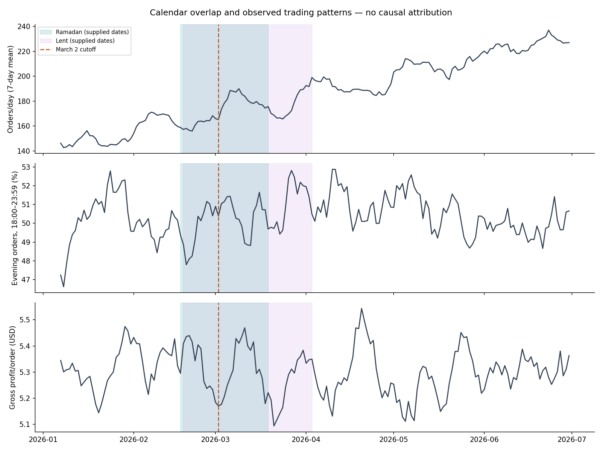
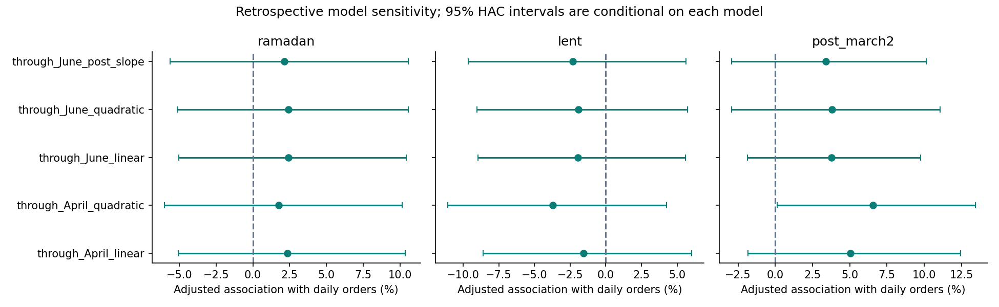

# Operating decisions under overlapping changes

**Business objective:** demonstrate that Stories can use observed demand, comparisons, and product economics to make defensible operating decisions during abrupt changes. Food offers are one decision; preparation quantities, daypart allocation, and promotion spending are others. Correctly naming the cause is useful but is not a prerequisite for every reversible operating action.

## Calendar and comparisons

Use the dates supplied by the user, inclusive. These are analysis assumptions, not an independent verification of religious-calendar dates or customers' observance.

| Phase | Dates, 2026 | Days | What it helps compare |
|---|---|---:|---|
| Before both, before March 2 | January 1–February 16 | 47 | Earlier demand and weekday patterns |
| Ramadan only | February 17 | 1 | Too short to isolate a reliable separate start effect |
| Ramadan and Lent, before March 2 | February 18–March 1 | 12 | Calendar-active demand before the disruption cutoff |
| Ramadan and Lent, after March 2 | March 2–18 | 17 | Compare with the prior phase, acknowledging trends |
| Lent only, after March 2 | March 19–April 2 | 15 | Check the Ramadan end while Lent remains active |
| After both, after March 2 | April 3–June 30 | 89 | Check persistence after the supplied calendar periods |

Calendar labels do not identify anyone's religion, fasting behavior, food restrictions, location, availability, or exposure to conflict.

## What the data show

These chain-wide comparisons use distinct transactions, with one complete week on either side of each boundary. Equal weekday exposure addresses weekday mix, not underlying growth or concurrent events.

| Boundary | Orders in prior week | Orders in following week | Change | Interpretation |
|---|---:|---:|---:|---|
| Joint calendar start, February 17 | 1,118 | 1,146 | +2.5% | Modest immediate volume difference; Ramadan and Lent starts cannot be separated reliably |
| March 2 | 1,162 | 1,311 | +12.8% | Larger immediate difference while both calendar flags stay active |
| Ramadan ends, March 19 | 1,221 | 1,176 | −3.7% | Some decline, but discount exposure also changes substantially |
| Lent ends, April 3 | 1,342 | 1,385 | +3.2% | No large immediate volume reversal |

Source: [calendar_boundary_comparisons.csv](calendar_boundary_comparisons.csv). Fourteen-day comparisons and branch-specific results are exported too; inspect them rather than treating a selected week as definitive.

**Additional robustness evidence from the earlier EDA:** alternative 28-day cutoffs throughout the available history all show chain-wide order growth, ranging from 5.9% to 10.7%; March 2 is +9.1%, within that range. Thus the larger adjacent-week March 2 change does not establish a unique structural break. Broad growth remains a strong competing explanation. [Alternative cutoff evidence](alternative_cutoff_comparisons.csv), [integrated exploratory findings](exploratory_findings.md).

**Ramadan-related timing hypothesis:** evening orders, defined strictly as 18:00–23:59, represent 50.0% of transactions before both periods, 50.2% during their overlap before March 2, 50.4% during the overlap after March 2, 51.0% during Lent alone, and 50.4% after both. These broad aggregates show no large shift toward evenings. That is not proof of no Ramadan effect: clock-time bins are coarse, branch patterns may differ, customer observance is unknown, and opening hours are missing. No sunset/iftar interpretation is assigned to the bin.

**Lent-related food-choice hypothesis:** beverage-order meal attachment is 2.07% before both periods, 2.03% during their pre–March 2 overlap, 2.41% during their post–March 2 overlap, 2.36% during Lent alone, and 2.33% after both. This does not show a clear sustained suppression followed by a rebound. Meals is a broad menu category, not a verified meat or fasting-suitable classification; ingredient and availability records are required before selecting Lent-specific products.

**Volume versus profitability:** recorded gross profit per order stays approximately $5.28–$5.32 across the multi-day phases. More orders do not establish higher contribution per order. Product mix, discounts, and operating costs must guide the action.

Source for these weighted phase rates: [calendar_phase_summary.csv](calendar_phase_summary.csv). The one-day Ramadan-only phase is explicitly excluded from narrative generalizations. [Category shares and economics by phase](calendar_category_phases.csv) allow a closer menu comparison without assuming dietary suitability.

## What can be attributed to Ramadan, Lent, or war?

The March 2 timing is more consistent with a post-cutoff change than with the *starts* of Ramadan or Lent, which occurred earlier. However, active religious periods can themselves evolve, and promotions and ongoing growth also change. These observations cannot uniquely identify the cause of the increase.

We fit exploratory retrospective regressions with weekday effects, a time trend, and separate Ramadan, Lent, and post–March 2 indicators. Sensitivity specifications change the trend shape, follow-up endpoint, or post-cutoff slope. Chain-wide order associations are:

- Ramadan: approximately **+1.7% to +2.4%**, with all five model-specific 95% intervals including zero.
- Lent: approximately **−3.7% to −1.6%**, with all five intervals including zero.
- Post–March 2: approximately **+3.4% to +6.6%**; four of five intervals include zero.

For the January–April linear specification, associations are Ramadan **+2.4% [−5.1%, +10.4%]**, Lent **−1.6% [−8.6%, +6.0%]**, and post–March 2 **+5.1% [−1.8%, +12.4%]**. Intervals use seven-lag HAC errors and are conditional on the model. They do not resolve confounding or account for the full specification search. A single nominally positive interval among many comparisons is not robust causal evidence.

Source: [calendar_adjusted_associations.csv](calendar_adjusted_associations.csv), [model diagnostics](calendar_model_diagnostics.csv). This is an explanatory sensitivity analysis using post-event outcomes, not a forecast that could have been deployed on March 2. The original pre-cutoff forecast remains a calendar-unadjusted reference, not an adjusted no-war estimate. Concurrent-event confounding and the value of multiple comparisons/control series are discussed in the [interrupted-time-series methods tutorial](https://pmc.ncbi.nlm.nih.gov/articles/PMC5407170/); robust covariance behavior follows the [statsmodels documentation](https://www.statsmodels.org/stable/generated/statsmodels.regression.linear_model.RegressionResults.get_robustcov_results.html).

An important alternative explanation is visible around Ramadan's end: discounted-unit exposure falls from **15.3% to 7.9%** across the adjacent weeks, while gross profit per order rises about **$0.10**. It would be unjustified to assign that profitability change entirely to Ramadan ending. The promotion calendar, not only the religious calendar, needs to be investigated.

## Decisions the evidence supports

| Observed signal | Defensible action | Evidence needed before a larger commitment |
|---|---|---|
| More orders around March 2, without a demonstrated large evening-share shift | Update branch/daypart preparation using recent same-weekday demand; avoid moving capacity toward evenings solely because it is Ramadan | Opening hours, stockouts, wait times, labor, and short-horizon forecast errors |
| Stable per-order recorded gross profit despite volume growth | Evaluate contribution per order and promotion costs, alongside volume | Incremental labor, waste, and promotion eligibility |
| No clear calendar-specific meal-attachment pattern | Compare normal-price bakery and meal suggestions in a randomized pilot, blocking by date/daypart | Offer response, ingredients, availability, extra preparation cost, and waste |
| Discount exposure changes near a calendar boundary | Audit promotion/product economics before crediting a calendar event or expanding discounts | Planned promotion dates and a randomized promotion test |
| Attribution is sensitive to trend assumptions | Make small reversible changes and monitor results; do not present a precise war/Ramadan/Lent decomposition | Longer historical data, prior-year comparable periods, and credible unaffected controls |

The existing preparation backtest improves Harbour bakery-unit MAE from 7.52 to 5.49 and meal-unit MAE from 2.90 to 2.20 using the prior four matching weekdays instead of a single prior weekday. This is evidence for the usefulness of recent-demand comparisons. It is not evidence of realized waste savings or an optimal stock quantity.

## Operational process

1. Record known calendar periods and promotion plans before examining the outcome.
2. Monitor orders, gross profit per order, food attachment, availability, and daypart shares separately by branch.
3. Compare with recent matching weekdays and show how results change across reasonable windows.
4. Change preparation in small steps when observed demand and service data justify it; do not infer optimal stock directly from sales.
5. Randomize offer alternatives within contemporaneous date/daypart blocks so treatment arms share calendar exposure. A treatment effect estimated in one calendar phase may not generalize to another.
6. Retain a change only if its measured incremental contribution and service/waste outcomes meet pre-agreed business thresholds.

**Claim to present:** Stories can use calendar-aware comparisons to challenge explanations and adapt preparation, promotions, and food offers during changing conditions. This dataset suggests a March 2-associated volume change, but does not reliably separate causal effects of war, Ramadan, and Lent.
