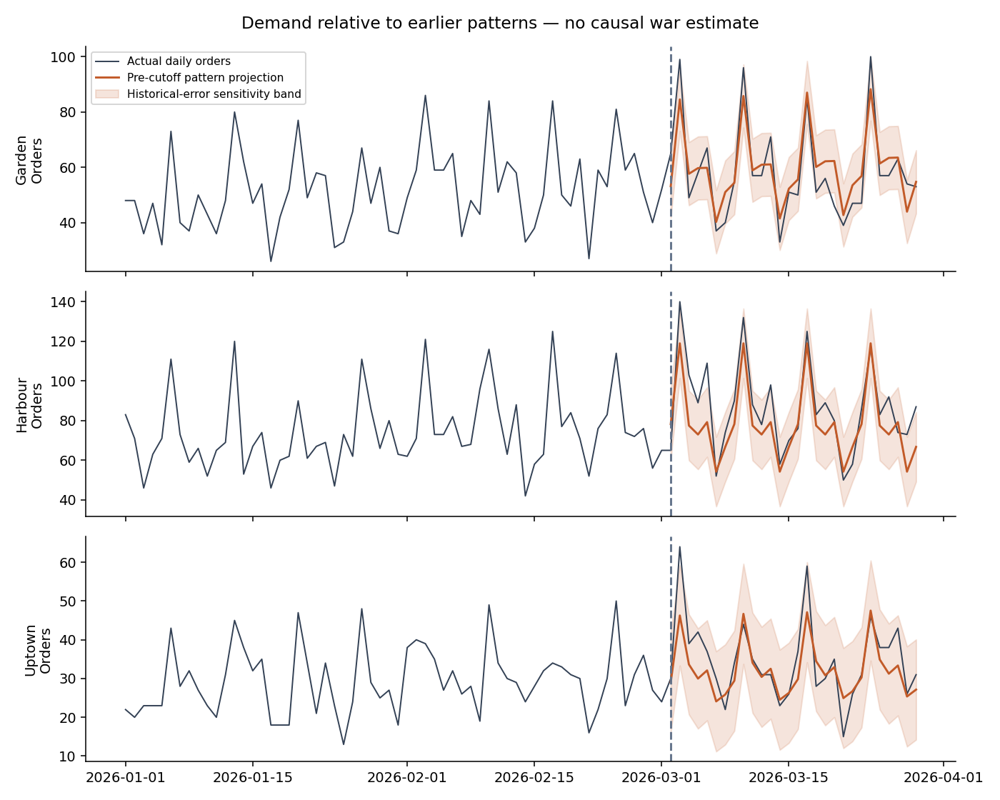

# Decision memo: pilot food suggestions before discounting

**Supporting investigation:** this earlier offer-specific memo is retained for reference. The primary problem statement and three business patterns are in [Business decisions during abrupt changes](decision_memo.md). The optional offer design is in [food_offer_pilot.md](../docs/food_offer_pilot.md).

**Calendar update:** read [Operating decisions under overlapping changes](calendar_decision_memo.md) first. Ramadan and Lent overlap the original before/after windows. The forecast below is a calendar-unadjusted reference. The project now centers on making defensible operating decisions during changing conditions; the food pilot is one application.

**Recommendation:** test normal-price bakery and meal suggestions at Harbour, with usual service as control. Continue branch-specific preparation planning and validate recorded costs before expanding offers across the chain. The supplied historical baskets cannot determine which offer creates the most additional profit.

## Evidence supporting the decision

All numbers below are recomputed from the supplied CSV. The matched windows are February 2–March 1 and March 2–29, 2026; the context cutoff comes from the user.

| March 2–29 | Garden | Harbour | Uptown |
|---|---:|---:|---:|
| Target beverage orders | 964 | 1,448 | 577 |
| Beverage orders with Bakery | 24.6% | 22.5% | 21.7% |
| Beverage orders with Meals | 3.7% | 1.7% | 2.1% |
| Beverage orders without Bakery or Meals | 695 | 1,099 | 440 |

Source: [basket_summary.csv](basket_summary.csv). The eligible-order counts are a historical completed-basket proxy. Live eligibility must be determined before any offer. Harbour has the largest candidate traffic pool, which makes it a practical pilot location. Low meal attachment could reflect an opportunity, limited interest, availability, or different eating occasions.

## Demand supports planning, not causal attribution

| Branch | Selected model | Actual orders, March 2–29 | Projected orders | Deviation |
|---|---|---:|---:|---:|
| Garden | Trend plus weekday | 1,640 | 1,676.8 | −2.2% |
| Harbour | Recent matching-weekday average | 2,419 | 2,192.0 | +10.4% |
| Uptown | Trend plus weekday | 971 | 901.7 | +7.7% |

Selection uses pre-cutoff chronological 14-day backtest MAE. Harbour's selected baseline has MAE **9.87 orders/day**, compared with **10.52** for the previous-weekday rule and **10.06** for trend plus weekday. The selected model is itself a simple baseline; more complexity did not improve its measured development score. Only three overlapping short-horizon folds and one 28-day fold are available. [Scores](forecast_backtest_scores.csv), [projection](projection_summary.csv).

Model choice matters: Garden's deviation ranges from **−2.2% to +5.1%**, changing sign. Harbour is **+5.3% to +12.0%** and Uptown **+7.7% to +13.0%** across candidates. This is useful sensitivity evidence, not a confidence interval. [All model projections](projection_model_sensitivity.csv).

Promotions, calendar effects, changing composition, and earlier growth remain alternative explanations. The shaded historical-error bands are not calibrated prediction intervals, and no causal no-war estimate has been established.

## Higher meal contribution comes with uncertain response

| Harbour food candidate | Normal-price contribution per extra unit | Existing beverage-pair baskets |
|---|---:|---:|
| Chocolate Cookie | $2.40 | 56 |
| Butter Croissant | $2.69 | 54 |
| Cinnamon Roll | $3.17 | 48 |
| Soup of the Day | $4.72 | 10 |
| Chicken Salad Bowl | $7.42 | 8 |
| Quinoa Bowl | $7.31 | 7 |

Source: [all product opportunities](product_opportunities.csv). These are food-only list-price contributions: beverage profit is already earned in the baseline order. Existing pair counts are small for meals and are not evidence that soup is the best meal offer. Operational suitability could favor another candidate. [Individual beverage/food pairs](observed_product_pairs.csv) are also available for targeting hypotheses.

Without additional costs or discounts, cookie needs **1.97 times** as many genuinely additional purchases to match soup contribution, or **3.09 times** to match salad contribution. Customer acceptance, labor, and spoilage can reverse the ranking. No category-level average should replace actual branch/product costs when setting an offer price.

## Conditional value and break-even

For 1,000 eligible orders, assume 5% additional attachment, 5% spontaneous baseline attachment, 10% substitution of a $2-contribution item, 10 extra wasted units, $0.25 additional operating cost per addition, and $50 fixed costs. These are scenario inputs, not observed outcomes.

| Harbour candidate | No discount: modeled contribution | No discount: break-even additional attachment | $1 discount: modeled contribution |
|---|---:|---:|---:|
| Chocolate Cookie | $38.40 | 3.03% | −$61.60 |
| Soup of the Day | $135.60 | 1.82% | $35.60 |

Source: [offer_scenarios.csv](offer_scenarios.csv), central cases. With a $1 discount, the scenario also charges $50 to baseline purchases that would have occurred anyway. Conservative no-discount cases are negative for both candidates. The lesson is to test normal-price prompts first and measure waste; these examples do not establish achievable savings or a winning product.

## Preparation and branch constraints

At Harbour, a daily preparation baseline using the previous four matching weekdays reduces observed bakery-unit MAE from **7.52 to 5.49** and meal-unit MAE from **2.90 to 2.20**, compared with the previous-weekday rule over March 2–June 30. This establishes better historical sales prediction for these fixed rules, not lower waste or fewer stockouts. Meal WAPE remains approximately **49.8%**, so availability and waste logs are especially valuable. [Preparation backtest](preparation_backtest.csv).

Across the full six months, Garden's recorded gross margin is **46.9%**, versus Harbour's **65.0%** and Uptown's **62.6%**. That supports using branch-specific costs, not assuming procurement savings are attainable. Audit whether cost definitions, recipes, supplier terms, and allocations are comparable. [Branch economics](branch_economics.csv).

Removing exact duplicate rows leaves order counts and all demand projections unchanged. Full-period gross profit per order changes by less than $0.02 at each branch; the broad branch comparison persists. Food economics and candidate ranks are separately exported for inspection under deduplication. [Duplicate sensitivity](duplicate_sensitivity.csv), [deduplicated products](product_opportunities_deduplicated.csv).

## What would change the action

- If observed incremental contribution is below a pre-agreed worthwhile threshold, retain usual service or redesign the prompt.
- If meals require substantially more waste or labor, bakery could be preferable despite lower product contribution.
- If recording errors explain cost differences, revise economics before pricing offers.
- If stockouts cap historical food sales, basket frequencies understate interest and preparation backtests understate demand.
- If pilot service effects or availability guardrails fail, do not expand on attachment alone.

Follow the [pilot specification](../docs/pilot.md): randomize eligible customers before offering, compare two normal-price suggestions with control, measure contribution per assigned order, and collect missing operating-cost and availability data. That test connects the historical evidence to a business action without presenting scenarios as measured benefits.
