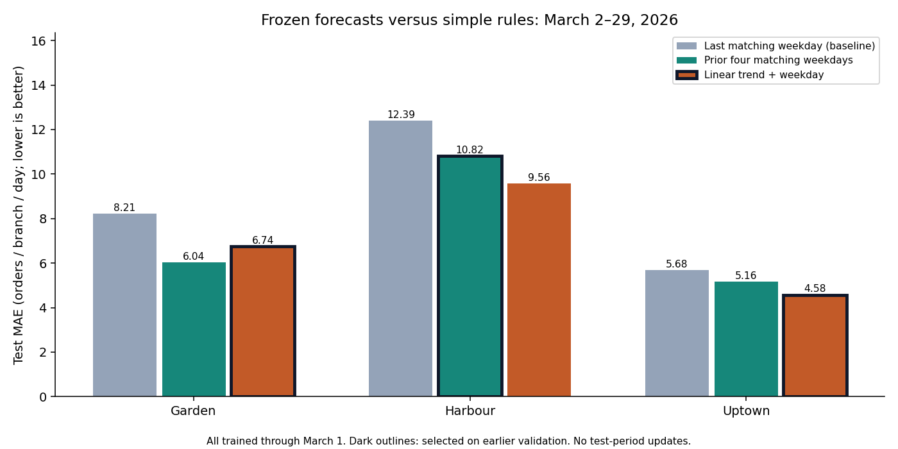

# Forecast models versus a simple baseline on later data

This evaluation supports the demand/preparation decision in Conclusion 1. It does not estimate the causal effect of war, Ramadan, or Lent.

**Training/refit:** January 01–March 01, 2026. **Model selection:** lowest mean MAE on three earlier 14-day validation folds (Jan 29–Feb 11; Feb 05–Feb 18; Feb 12–Feb 25). Those folds overlap; they are development comparisons, not independent final tests.

**Separate test:** March 02–March 29, 2026 (28 days per branch). Fit every candidate through March 1 and issue the whole 28-day forecast once. Do not update with test-period sales, refit on them, or use them to choose a replacement winner. The baseline repeats the most recent matching weekday available on March 1. All three candidates use exactly the same history and target dates.

**Retrospective scope:** these dates have appeared in the exploratory analysis. They are excluded from fitting and the coded selection rule, rather than a never-inspected or prospective test. New future data are needed to confirm generalization.

**Metrics:** MAE is the mean absolute error in orders per branch per day (lower is better). WAPE is total absolute error divided by total recorded orders. Positive MAE reduction means improvement over the simple baseline. Bias is prediction minus actual, averaged over days.

| Branch | Candidate | Chosen on earlier validation? | Test MAE | Test WAPE | MAE reduction vs baseline |
|---|---|---|---:|---:|---:|
| Garden | Last matching weekday (baseline) |  | 8.21 | 14.0% | 0.0% |
| Garden | Prior four matching weekdays |  | 6.04 | 10.3% | 26.5% |
| Garden | Linear trend + weekday | Yes | 6.74 | 11.5% | 17.9% |
| Harbour | Last matching weekday (baseline) |  | 12.39 | 14.3% | 0.0% |
| Harbour | Prior four matching weekdays | Yes | 10.82 | 12.5% | 12.7% |
| Harbour | Linear trend + weekday |  | 9.56 | 11.1% | 22.8% |
| Uptown | Last matching weekday (baseline) |  | 5.68 | 16.4% | 0.0% |
| Uptown | Prior four matching weekdays |  | 5.16 | 14.9% | 9.1% |
| Uptown | Linear trend + weekday | Yes | 4.58 | 13.2% | 19.4% |

**Reading the result:**

- Garden: the earlier-selected linear trend + weekday has test MAE 6.74 versus 8.21 for last matching weekday (17.9% lower). The lowest test error among all candidates is 6.04 for prior four matching weekdays.
- Harbour: the earlier-selected prior four matching weekdays has test MAE 10.82 versus 12.39 for last matching weekday (12.7% lower). The lowest test error among all candidates is 9.56 for linear trend + weekday.
- Uptown: the earlier-selected linear trend + weekday has test MAE 4.58 versus 5.68 for last matching weekday (19.4% lower). The lowest test error among all candidates is 4.58 for linear trend + weekday.

Compare each selected candidate with both simple rules, rather than assuming that a regression must be better. Keep losses visible and do not switch the reported selection using this test. This one short, overlapping-event period does not establish statistical superiority or lasting forecast accuracy.

**Business use:** pilot the transparent recent-weekday preparation rule and monitor forecast error, stockouts, waste, and service. Lower sales forecast error is not measured profit or an optimal stock level. The separate food-unit backtest updates each day using only prior sales; it has a different horizon and target and is not this frozen order-forecast test.

Outlined bars mark choices made using earlier validation. The bars show point errors on 28 days, not confidence intervals. Reproduce with `PYTHONPATH=src python3 -m stories.analysis`. See [per-date predictions](forecast_holdout_predictions.csv) and [full test scores](forecast_holdout_scores.csv).
